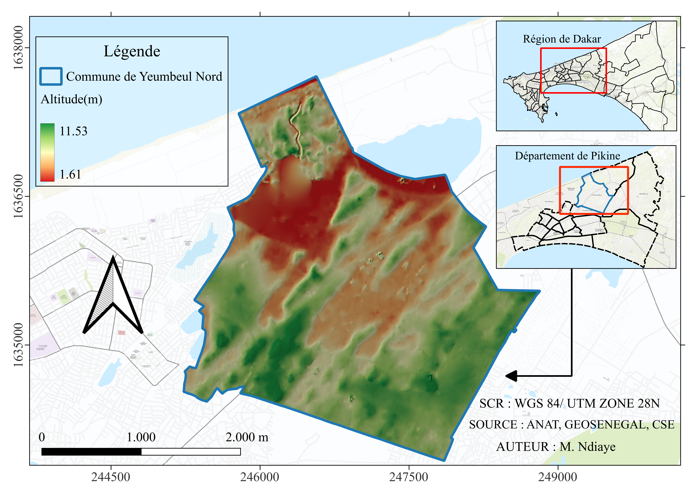
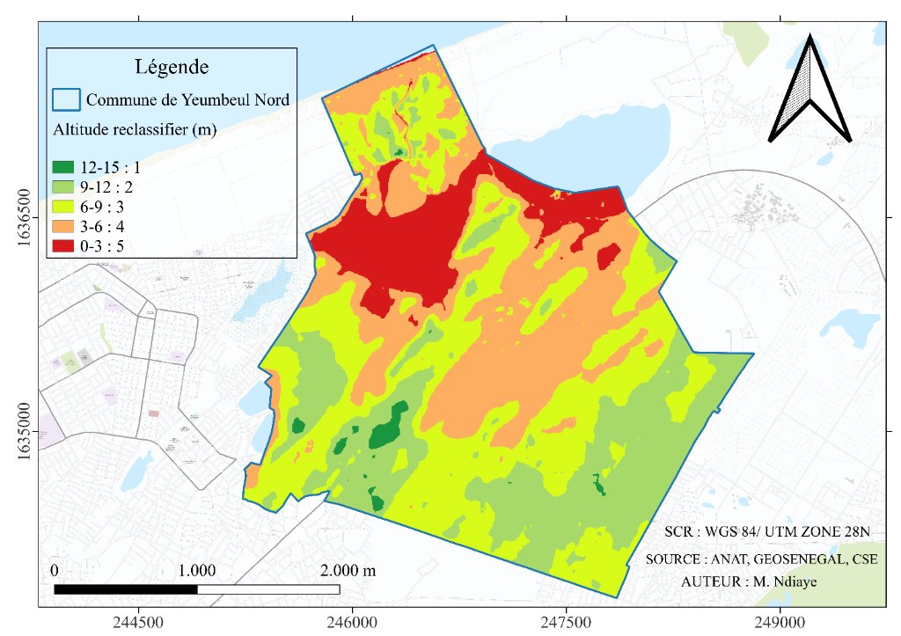
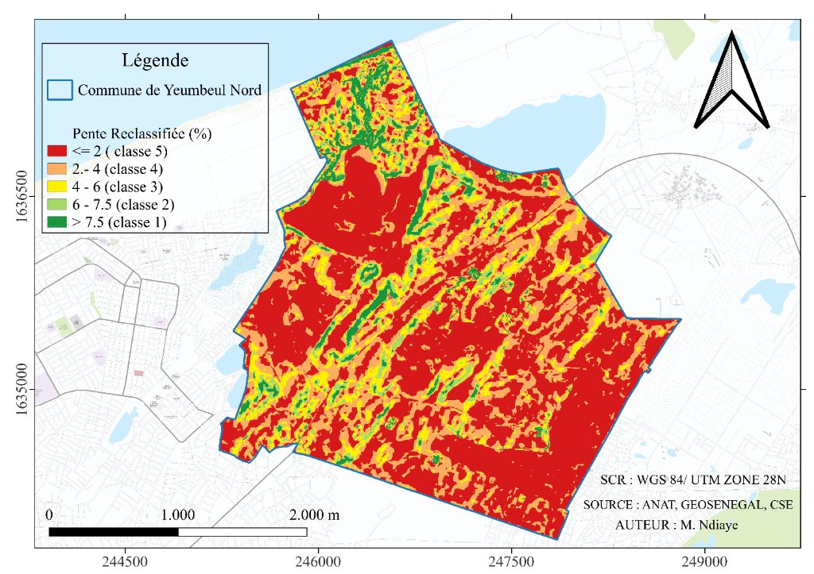
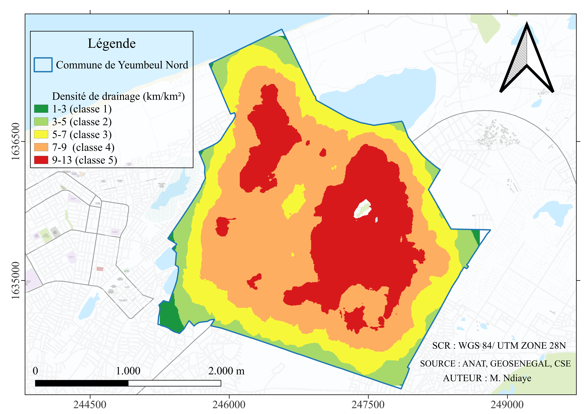
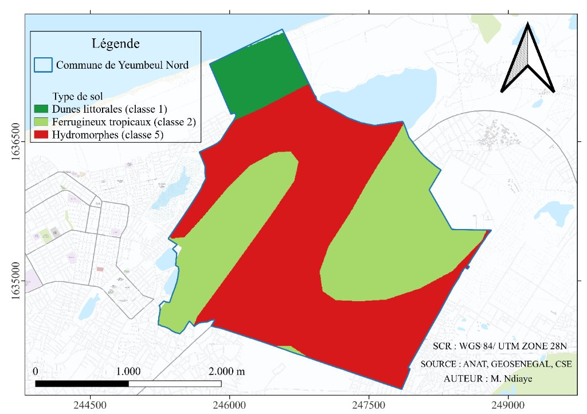
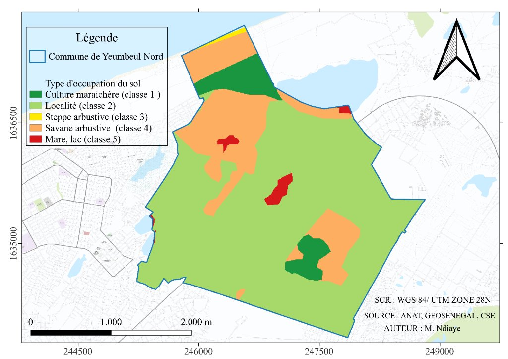

# Évaluation de la Susceptibilité aux Inondations par Analyse Spatiale Multicritère (AHP) et Exposition des Enjeux
### Cas d'étude : Commune de Yeumbeul Nord (Dakar, Sénégal)

> **Projet académique** : Licence 3 Géomatique – Département Géosciences Appliquées et Environnement  
> **Auteur** : M. Ndiaye  
> **Cadre méthodologique** : Modélisation multicritère sous QGIS basée sur les travaux de Sy, Mbow & Aw (2025, *VertigO*)  
> **Système de Coordonnées de Référence (SCR)** : WGS 84 / UTM Zone 28N (EPSG: 32628)  
> **Résolution spatiale des données** : 5 mètres  
> **Logiciels mobilisés** : QGIS (Easy AHP, Calculatrice raster, Outils d'intersection), Microsoft Excel  

---

## Résumé Exécutif

Face aux inondations récurrentes qui frappent la banlieue dakaroise, cette étude met en œuvre une démarche d'**Analyse Multicritère Hiérarchique (AHP)** sous **QGIS** pour modéliser la susceptibilité aux inondations dans la **commune de Yeumbeul Nord**. En s'appuyant sur la matrice de comparaison et la pondération validée par l'étude de **Sy, Mbow & Aw (2025)** publiée dans la revue *VertigO*, cinq facteurs conditionnants à haute résolution spatiale (5 m) ont été harmonisés et combinés : l'**altitude**, la **pente**, la **densité de drainage**, la **pédologie** et l'**occupation du sol**. 

L'analyse spatiale révèle que **28.63 %** de l'espace communal présente une susceptibilité élevée à très élevée, concentrée dans les cuvettes interdunaires et autour du lac Warouwaye. Ce document décrit le protocole SIG de manière rigoureusement reproductible, quantify les surfaces affectées et pose les bases du croisement spatial avec les **enjeux vulnérables (bâti et réseau routier)**, tout en ouvrant des perspectives pour l'automatisation prédictive par **Machine Learning**.

> ⚠️ *Note sur les limites administratives* : Les découpages communaux utilisés correspondent à la base d'étude actuelle et s'actualiseront automatiquement lors de l'intégration des limites officielles révisées avec la mairie.

---

## 1. Introduction

Les inondations constituent l'une des catastrophes naturelles les plus dévastatrices au monde **(Li, 2026)**. Elles se traduisent par la submersion temporaire de territoires habités ou productifs. La complexité de la gestion de ce risque tient à la diversité de ses manifestations : inondations urbaines, torrentielles, fluviales, côtières, pluviales ainsi que les inondations par remontée de nappe phréatique. Face à ces aléas récurrents, il est indispensable de développer des outils de diagnostic spatial précis pour protéger la population, préserver les infrastructures et guider l'aménagement territorial.

L'épisode de grande sécheresse des années 1970 au Sahel a marqué un tournant fondamental dans l'organisation urbaine de Dakar. Fuyant la dégradation des conditions de vie rurales, des milliers de ménages ont convergé vers la presqu'île du Cap-Vert, provoquant une extension spontanée et non planifiée de la périphérie dakaroise. Faute d'aménagements préalables, ces populations ont colonisé les bas-fonds et dépressions interdunaires des Niayes, des zones humides temporairement asséchées par le déficit de pluie de l'époque. Avec la réactivation des cycles pluviométriques normaux à abondants depuis les années 2000, ces secteurs se retrouvent sous l'eau à chaque saison des pluies.

La **commune de Yeumbeul Nord** est emblématique de cette situation. Située au cœur du département de Keur Massar (anciennement Pikine), elle subit des inondations chroniques dont les crises majeures de **2005, 2009 et 2012** ont durablement marqué la mémoire collective et le tissu urbain **(Sy, 2019 ; Diongue, 2014)**.

### Objectifs de l'Étude

Afin d'apporter une réponse méthodologique rigoureuse et opérationnelle, cette étude poursuit **trois objectifs interconnectés** :

* **Objectif 1 : Élaborer la carte globale de susceptibilité aux inondations**  
  Croiser les facteurs physico-spatiaux majeurs sous QGIS par l'Analyse Hiérarchique des Procédés (AHP), standardisée à une résolution fine de **5 mètres**.
* **Objectif 2 : Quantifier la répartition surfacique par degré de susceptibilité**  
  Calculer précisément la proportion (en % et en hectares) des différentes classes de risque (Très faible, Faible, Moyen, Élevé, Très élevé) pour caractériser la vulnérabilité globale du territoire.
* **Objectif 3 : Évaluer l'exposition des enjeux vulnérables (bâti et voirie)**  
  Croiser la couche de susceptibilité issue de l'AHP avec la couche du bâti (`enjeux_bati.png`) et celle du réseau routier (`enjeux_routes.png`) par intersection spatiale, afin d'identifier les bâtiments et les tronçons de voirie situés en zone critique d'inondation.

---

## 2. Zone d'Étude

La commune de Yeumbeul Nord se situe sur la presqu'île du Cap-Vert, dans la région de Dakar. Elle est délimitée par les coordonnées projetées en WGS 84 / UTM Zone 28N comprises entre 245 000 m et 250 000 m en Est (X) et 1 634 000 m et 1 637 500 m en Nord (Y).

| Paramètre | Caractéristique |
| :--- | :--- |
| **Entité administrative** | Commune de Yeumbeul Nord, Département de Keur Massar |
| **Relief** | Système dunaire des Niayes (dunes rouges ogoliennes et cuvettes) |
| **Altitude minimale** | **1.61 m** (Cœur des Niayes et abords du lac Warouwaye) |
| **Altitude maximale** | **11.53 m** (Crêtes dunaires) |
| **Exutoire** | Bassin fermé (endoréique), absence de drainage naturel vers la mer |
| **Enjeux majeurs** | Habitat très dense, axes routiers stratégiques, cuvettes maraîchères |


*Figure 1 : Carte de situation régionale et topographie de la commune de Yeumbeul Nord.*

---

## 3. Méthodologie et Données d'Entrée

Pour garantir une **reproductibilité intégrale** (permettant à tout géomaticien disposant des mêmes données de parvenir rigoureusement aux mêmes résultats), l'ensemble du protocole a été réalisé **exclusivement sous QGIS**, complété par **Excel** pour le traitement statistique des surfaces.

### 3.1 Schéma Méthodologique Global

```
  [ DONNÉES D'ENTRÉE BRUTES - Résolution 5m / EPSG:32628 ]
  (MNT local, Pente dérivée, Densité drainage, Sols, Occupation du sol)
                            │
                            ▼
     [ ÉTAPE 1 : Reclassification sous QGIS ]
     (Outil : "Reclassifier par table" -> Échelle 1 à 5)
                            │
                            ▼
     [ ÉTAPE 2 : Pondération AHP ]
     (Matrice Saaty / Plugin Easy AHP / Réf: Sy, Mbow & Aw 2025)
     (Calcul des poids Wi et vérification du ratio CR = 1.51% < 10%)
                            │
                            ▼
     [ ÉTAPE 3 : Combinaison Linéaire Pondérée (WLC) ]
     (Outil : "Calculatrice Raster" de QGIS)
                            │
        ┌───────────────────┴───────────────────┐
        ▼                                       ▼
 [ OBJECTIF 1 : CARTE AHP ]           [ OBJECTIF 2 : SURFACES % ]
 Raster continu discrétisé           (Vectorisation -> Calculatrice
 en 5 classes (Jenks)                 de champs -> Export Excel/CSV)
        │
        ▼
 [ OBJECTIF 3 : EXPOSITION DES ENJEUX ]
 (Vectorisation "ahp_final.shp" + Outil "Intersection")
 ┌───────────────────────┴───────────────────────┐
 ▼                                               ▼
[ Enjeux Bâti : ahp ⋂ bâti ]        [ Enjeux Routes : ahp ⋂ voirie ]
(Carte : enjeux_bati.png)           (Carte : enjeux_routes.png)
```

---

### 3.2 Spécifications des Données d'Entrée

Toutes les couches ont été projetées dans le système officiel **WGS 84 / UTM Zone 28N (EPSG: 32628)** et harmonisées à une résolution spatiale régulière de **5 mètres**.

| Couche facteur | Type de donnée | Source | Rôle physique dans l'inondation |
| :--- | :---: | :---: | :--- |
| **Altitude (MNT)** | Raster 5m | CSE / MNT local | Piégeage gravitaire des eaux dans les points bas |
| **Pente (Slope)** | Raster 5m | Dérivé du MNT | Vitesse d'écoulement et stagnation superficielle |
| **Densité de drainage** | Raster 5m | Réseau hydrographique | Concentration spatiale des écoulements |
| **Pédologie** | Vecteur ➔ Raster 5m | Direction des Sols / CSE | Taux d'infiltration et perméabilité lithologique |
| **Occupation du sol** | Vecteur ➔ Raster 5m | ANAT / GeoSénégal | Imperméabilisation et rétention de surface |
| **Enjeux Bâti** | Vecteur (Polygones) | Cadastre / BD Urbaine | Localisation des habitations exposées |
| **Enjeux Routes** | Vecteur (Lignes) | Voirie urbaine / OSM | Axes de circulation vulnérables aux coupures |

---

### 3.3 Reclassification des Facteurs sous QGIS (Outil « Reclassifier par table »)

Chaque facteur a été discrétisé en **5 classes de susceptibilité** (1 = Très faible, 2 = Faible, 3 = Moyen, 4 = Élevé, 5 = Très élevé) via l'outil **Reclassifier par table** (*Reclassify by table*) de la boîte à outils QGIS :

#### Facteur 1 : L'Altitude (MNT)
L'eau s'accumule dans les dépressions d'altitude inférieure à 3 mètres (Note 5, en rouge), tandis que les crêtes dunaires supérieures à 12 mètres assurent un écoulement libre (Note 1, en vert).

| Tranche d'altitude (m) | Note de susceptibilité | Appréciation |
| :---: | :---: | :--- |
| **0 – 3 m** | **5** | Très élevé |
| **3 – 6 m** | **4** | Élevé |
| **6 – 9 m** | **3** | Moyen |
| **9 – 12 m** | **2** | Faible |
| **12 – 15 m** | **1** | Très faible |


*Figure 2 : Carte de l'altitude reclassifiée.*

---

#### Facteur 2 : La Pente du Terrain (%)
Générée via l'outil *Pente* de QGIS. Les zones planes (pente ≤ 2 %) empêchent l'évacuation pluviale et reçoivent la note 5. Les fortes pentes (> 7.5 %) facilitent le drainage gravitaire.

| Pente (%) | Note de susceptibilité | Appréciation |
| :---: | :---: | :--- |
| **≤ 2 %** | **5** | Très élevé (Stagnation critique) |
| **2 – 4 %** | **4** | Élevé |
| **4 – 6 %** | **3** | Moyen |
| **6 – 7.5 %** | **2** | Faible |
| **> 7.5 %** | **1** | Très faible (Écoulement rapide) |


*Figure 3 : Carte des pentes reclassifiées.*

---

#### Facteur 3 : La Densité de Drainage (km/km²)
Calculée par densité de lignes sous QGIS. Les concentrations supérieures à 9 km/km² correspondent aux couloirs majeurs d'apport pluvial.

| Densité (km/km²) | Note de susceptibilité | Appréciation |
| :---: | :---: | :--- |
| **9 – 13** | **5** | Très élevé |
| **7 – 9** | **4** | Élevé |
| **5 – 7** | **3** | Moyen |
| **3 – 5** | **2** | Faible |
| **1 – 3** | **1** | Très faible |


*Figure 4 : Carte de la densité de drainage reclassifiée.*

---

#### Facteur 4 : La Pédologie (Types de Sol)
Rasterisée à 5 m depuis la couche pédologique. Les sols hydromorphes engorgés d'eau au centre de la commune sont imperméables (Note 5). Les sables dunaires littoraux très filtrants permettent une forte infiltration (Note 1).

| Type de sol | Note de susceptibilité | Perméabilité |
| :--- | :---: | :--- |
| **Sols hydromorphes** | **5** | Imperméable / Nappe saturée |
| **Ferrugineux tropicaux** | **2** | Perméabilité moyenne |
| **Dunes littorales** | **1** | Très perméable (Forte absorption) |


*Figure 5 : Carte pédologique reclassifiée.*

---

#### Facteur 5 : L'Occupation du Sol (LULC)
L'état de surface conditionne l'imperméabilisation :

| Classe d'occupation | Note de susceptibilité | Rôle hydrologique |
| :--- | :---: | :--- |
| **Mare, lac (Warouwaye)** | **5** | Submersion permanente |
| **Savane arbustive** | **4** | Ruissellement important |
| **Steppe arbustive** | **3** | Infiltration modérée |
| **Localité (bâti)** | **2** | Tissu habité dense |
| **Culture maraîchère** | **1** | Espace ouvert perméable |


*Figure 6 : Carte de l'occupation du sol reclassifiée.*

---

### 3.4 Pondération AHP et Vérification de Consistance (Plugin « Easy AHP »)

La détermination des poids des critères s'appuie sur la matrice de comparaison par paires issue des travaux de **Sy, Mbow & Aw (2025, revue *VertigO*)** appliqués aux départements de Pikine et Keur Massar. 

La matrice a été injectée dans le plugin QGIS **Easy AHP** pour calculer automatiquement les poids et valider le ratio de cohérence de Saaty :

| Critères | Altitude | Pente | Densité Drainage | Pédologie | Occupation Sol |
| :--- | :---: | :---: | :---: | :---: | :---: |
| **Altitude** | 1.000 | 2.000 | 3.000 | 4.000 | 5.000 |
| **Pente** | 0.500 | 1.000 | 2.000 | 3.000 | 4.000 |
| **Densité Drainage** | 0.333 | 0.500 | 1.000 | 2.000 | 3.000 |
| **Pédologie** | 0.250 | 0.333 | 0.500 | 1.000 | 2.000 |
| **Occupation Sol** | 0.200 | 0.250 | 0.333 | 0.500 | 1.000 |

#### Poids relatifs obtenus :
- **Altitude (MNT)** : **41.62 %** (poids décimal = 0.4162)
- **Pente du terrain** : **26.18 %** (poids décimal = 0.2618)
- **Densité de drainage** : **16.10 %** (poids décimal = 0.1610)
- **Pédologie (Sols)** : **9.86 %** (poids décimal = 0.0986)
- **Occupation du sol** : **6.24 %** (poids décimal = 0.0624)
- **Total** : **100.00 %**

#### Validation mathématique de cohérence :
- Nombre de critères : **n = 5**
- Valeur propre maximale : **λ max = 5.0678**
- Indice de Cohérence : `CI = (5.0678 - 5) / (5 - 1) = 0.0169`
- Indice Aléatoire de Saaty : `RI = 1.12`
- **Ratio de Cohérence (CR)** : `CR = CI / RI = 0.0169 / 1.12 = 0.0151` (**1.51 %**)

> **Validation** : Le ratio de cohérence (**CR = 1.51 %**) est très inférieur à la limite maximale tolérée de **10 %** (CR < 0.10), ce qui certifie l'excellente rigueur logique et l'absence de contradiction dans la comparaison des facteurs.

### 3.5 Combinaison Linéaire Pondérée sous QGIS (Calculatrice Raster)

L'intégration a été effectuée dans la **Calculatrice Raster** de QGIS en appliquant l'équation WLC :

```plaintext
AHP_Yeumbeul = (0.4162 * "re_dem@1") + (0.2618 * "re_pente@1") + (0.1610 * "re_dd@1") + (0.0986 * "re_pedologie@1") + (0.0624 * "re_ocsol@1")
```

---

## 4. Résultats et Analyse Spatiale

### 4.1 Objectif 1 : Carte Finale de Susceptibilité AHP

Le raster continu obtenu a été classé en 5 degrés de susceptibilité par la méthode des seuils naturels (Jenks) sous QGIS :


*Figure 7 : Carte finale de susceptibilité aux inondations de la commune de Yeumbeul Nord.*

---

### 4.2 Objectif 2 : Quantification Surfacique des Classes (QGIS + Excel)

Pour quantifier précisément chaque classe :
1. Le raster AHP a été vectorisé en polygones (`ahp_final.shp`) dans QGIS.
2. Les polygones ont été dissous/combinés par code de classe (DN 1 à 5).
3. Les superficies ont été calculées via la calculatrice de champs (fonction d'aire automatique de QGIS).
4. Les données ont été traitées sous **Microsoft Excel** pour calculer les proportions relatives en pourcentage (%) et générer le diagramme de synthèse, puis exportées sous `ahp_diagramme.csv`.

| Classe DN | Degré de Susceptibilité | Proportion (%) | Diagnostic territorial |
| :---: | :--- | :---: | :--- |
| **1** | **Très faible** | **0.29 %** | Crêtes dunaires sommitales, zone hors d'eau garantie |
| **2** | **Faible** | **5.09 %** | Versants dunaires à bon écoulement gravitaire |
| **3** | **Moyen** | **65.98 %** | Zone tampon intermédiaire sensible aux pluies extrêmes |
| **4** | **Élevé** | **20.82 %** | Abords immédiats des bas-fonds et tissu urbain dense |
| **5** | **Très élevé** | **7.81 %** | Cœur des dépressions, lac Warouwaye, submersion permanente |


*Figure 8 : Répartition surfacique (%) des degrés de susceptibilité aux inondations.*

---

### 4.3 Objectif 3 : Évaluation de l'Exposition des Enjeux (Bâti et Routes)

Pour évaluer concrètement l'impact des inondations sur les activités humaines et les infrastructures, la couche vectorielle de susceptibilité (`ahp_final.shp`) est croisée par l'outil **Intersection** de QGIS avec les couches d'enjeux :

#### A. Exposition du Bâti (Intersection : couche AHP ⋂ couche Bâti)
L'intersection spatiale permet d'identifier le nombre et l'emprise des bâtiments situés dans les zones de susceptibilité **Élevée** et **Très élevée** :
- Les constructions établies dans les dépressions interdunaires présentent une vulnérabilité structurelle majeure due à la stagnation prolongée de l'eau et aux fissurations par remontée de nappe.
- *Livrable cartographique associé* : `enjeux_bati.png` (en cours de finalisation).

#### B. Exposition du Réseau Routier (Intersection : couche AHP ⋂ couche Routes)
Le croisement avec les axes de voirie calcule le linéaire de routes (en kilomètres) submersible :
- L'inondation des axes routiers stratégiques de Yeumbeul Nord entraîne l'enclavement immédiat de plusieurs quartiers et empêche le passage des motopompes et des véhicules de secours.
- *Livrable cartographique associé* : `enjeux_routes.png` (en cours de finalisation).

---

## 5. Perspectives : Automatisation Prédictive par Machine Learning

Bien que l'Analyse Multicritère AHP apporte une évaluation solide, elle repose sur une pondération experte. La perspective majeure de ce travail consiste à utiliser cette cartographie pour alimenter un pipeline d'**apprentissage automatique (Machine Learning supervisé)** afin d'automatiser et de rendre dynamique la détection des zones d'inondation :

```
             [ Cartographie AHP Validée (5 Classes) ]
                                │
                                ▼
       [ Échantillonnage Stratifié SANS Bruit d'Étiquetage ]
        ├── Classe 1 (Inondable) : Classes 4 et 5 (Élevé + Très Élevé)
        ├── Classe 0 (Non Inondable) : Classes 1 et 2 (Très Faible + Faible)
        └── Exclusion stricte de la classe 3 (Moyen) pour éviter le bruit
                                │
                                ▼
       [ Modélisation Prédictive : Random Forest / XGBoost ]
        Extraction des covariables (Altitude, Pente, TWI, Sol, Drainage)
                                │
                                ▼
       [ Prédiction Automatisée des Futures Zones d'Aléa ]
```

Un premier échantillonnage équilibré de **465 points d'apprentissage** (234 inondables / 231 non inondables) a été extrait via le script Python [`sample_generator.py`](file:///c:/formation_qgis_2026/exo_amc/sample_generator.py) et sauvegardé sous [`donnees/echantillons_ml.csv`](file:///c:/formation_qgis_2026/exo_amc/donnees/echantillons_ml.csv) pour amorcer ces futurs développements.

---

## 6. Recommandations pour la Mairie de Yeumbeul Nord

À l'issue de cette modélisation, trois recommandations stratégiques sont formulées pour les services techniques municipaux et les gestionnaires de crise (ONAS, PROGEP) :
1. **Sanctuarisation des bas-fonds** : Interdire toute nouvelle construction dans les zones classées en susceptibilité très élevée (autour du lac Warouwaye et cuvettes pérennes).
2. **Priorisation du réseau de drainage** : Dimensionner les caniveaux et stations de pompage en suivant les axes de concentration naturelle révélés par la carte de densité de drainage.
3. **Plan de secours par quartier** : Utiliser la couche des 82 quartiers pour organiser le secours d'urgence et le déploiement ciblé des motopompes dès les premières alertes météorologiques.

---

## 7. Références Bibliographiques

- **Diongue, M.** (2014). *Périphérie urbaine et risques d'inondation à Dakar (Sénégal) : Le cas de Yeumbeul Nord*. ESO Travaux et Documents, (37), 23-34.
- **Li, et al.** (2026). *Coupled Multi-Criteria Decision-Making and Machine Learning Approaches for Spatial Flood Susceptibility Prediction*. ScienceDirect / Geoscience Frontiers. [DOI: 10.1016/j.gsf.2026.1001854](https://www.sciencedirect.com/science/article/pii/S1674987126001854)
- **Saaty, T. L.** (1980). *The Analytic Hierarchy Process: Planning, Priority Setting, Resource Allocation*. McGraw-Hill International, New York.
- **Sy, B.** (2019). *Approche multidisciplinaire de l'évaluation de l'aléa d'inondation à Yeumbeul Nord, Dakar, Sénégal : la contribution de la science citoyenne*. Thèse de doctorat, Université de Genève, n° 5340. [Archive ouverte UNIGE](https://archive-ouverte.unige.ch/unige:126388)
- **Sy, B., Mbow, M., & Aw, S.** (2025). *Cartographie de la susceptibilité d'inondation, basée sur l'Analyse Hiérarchique des Procédés (AHP) dans les départements de Pikine et de Keur Massar, Sénégal*. *VertigO - la revue électronique en sciences de l'environnement*, Vol. 25-2. [https://journals.openedition.org/vertigo/50627](https://journals.openedition.org/vertigo/50627)
