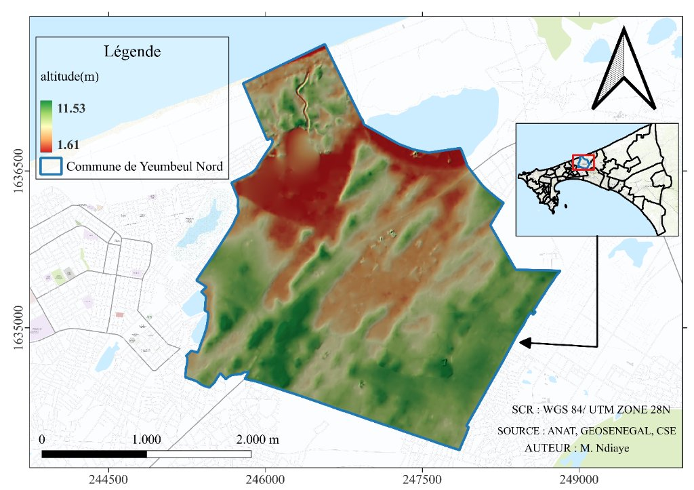
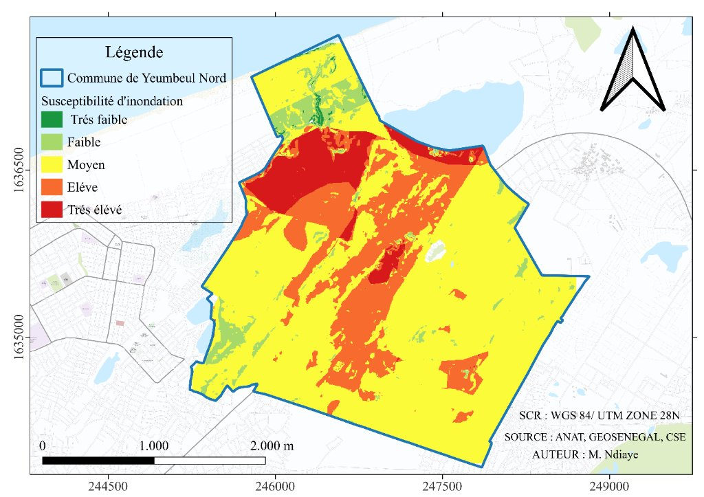
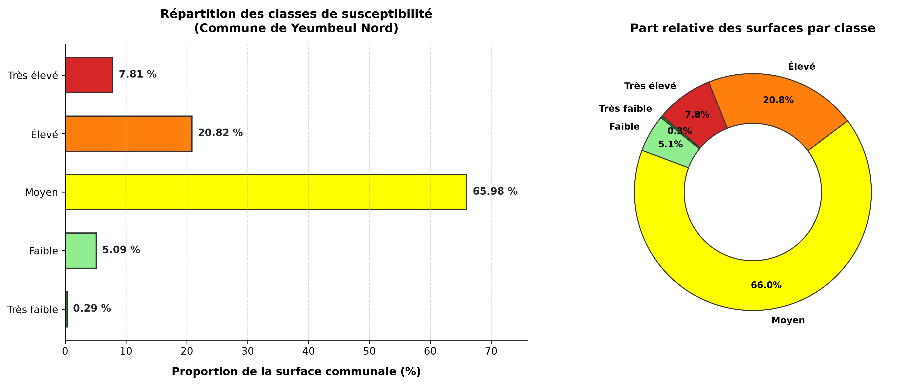

# Évaluation de la Susceptibilité aux Inondations et Modélisation Prédictive par Machine Learning
### Cas d'étude : Commune de Yeumbeul Nord (Dakar, Sénégal)

> **Auteur** : M. Ndiaye  
> **Cadre** : Analyse Spatiale multicritère (AHP) & Machine Learning appliqué à la gestion des risques hydrologiques  
> **Système de Coordonnées de Référence (SCR)** : WGS 84 / UTM Zone 28N (EPSG: 32628)  
> **Sources de données** : ANAT, GEOSENEGAL, CSE, SRTM / MNT local

---

## 📌 Résumé du Projet

Ce projet a pour objectif d'évaluer et de cartographier la susceptibilité aux inondations dans la **commune de Yeumbeul Nord** par une méthode d'**Analyse Multicritère Hiérarchique (AHP)**, puis d'exploiter ces résultats comme base d'apprentissage pour concevoir un pipeline automatisé de détection des zones à risque basé sur des algorithmes de **Machine Learning** (Random Forest, XGBoost).

> ⚠️ *Note sur les limites administratives* : Les découpages communaux utilisés dans cette version préliminaire sont en cours de révision en concertation avec les services techniques municipaux. La structure du rapport et le code sont conçus pour s'actualiser automatiquement lors de la mise à jour des limites.

---

## 1. Contexte et Zone d'Étude

La commune de Yeumbeul Nord, située dans la banlieue dakaroise, est caractérisée par une topographie dunaire alternant entre crêtes sableuses et dépressions interdunaires (niayes) soumises à une forte pression d'urbanisation. Ces dépressions constituent des zones naturelles de convergence des eaux de ruissellement et d'affleurement de la nappe phréatique.

| Paramètre | Description |
| :--- | :--- |
| **Localisation** | Presqu'île du Cap-Vert, Dakar, Sénégal |
| **Altitude minimale** | ~1.61 m |
| **Altitude maximale** | ~11.53 m |
| **Facteurs de risque majeurs** | Topographie basse, imperméabilisation du sol, remontée de la nappe |


*Figure 1 : Carte de situation et modèle altimétrique de Yeumbeul Nord.*

---

## 2. Cartographie de la Susceptibilité par AMC (AHP)

L'approche multicritère Saaty (AHP) a permis de croiser plusieurs facteurs conditionnants prédisposant aux inondations :
1. **Altitude (MNT)** : Les cuvettes basses favorisent la stagnation.
2. **Pente (Slope)** : Les faibles pentes ralentissent l'évacuation des eaux.
3. **Indice d'Humidité Topographique (TWI)** : Identifie les zones d'accumulation d'eau.
4. **Densité de Drainage (DD)** : Concentration des réseaux hydrographiques naturels ou fossiles.
5. **Occupation du Sol (LULC)** : Taux d'imperméabilisation et densité du bâti.
6. **Pédologie** : Propriétés d'infiltration et perméabilité des sols.

Le résultat a été discrétisé en **5 classes de susceptibilité** :


*Figure 2 : Carte de susceptibilité aux inondations (AHP) de Yeumbeul Nord.*

---

## 3. Analyse Statistique et Répartition des Surfaces

Le calcul zonal sur la commune met en évidence la répartition suivante :

| Classe DN | Niveau de Susceptibilité | Proportion surfacique (%) | Interprétation |
| :---: | :--- | :---: | :--- |
| **1** | **Très faible** | **0.29 %** | Crêtes dunaires hautes et fortes pentes |
| **2** | **Faible** | **5.09 %** | Zones de versants bien drainées |
| **3** | **Moyen** | **65.98 %** | Zone tampon intermédiaire (majoritaire) |
| **4** | **Élevé** | **20.82 %** | Bordures de bas-fonds et tissu urbain dense |
| **5** | **Très élevé** | **7.81 %** | Cœur des cuvettes et zones inondables récurrentes |


*Figure 3 : Répartition surfacique des classes de susceptibilité aux inondations.*

---

## 4. Protocole d'Échantillonnage pour le Machine Learning

Pour dépasser l'approche heuristique (AHP) et automatiser la prédiction par **Machine Learning supervisé**, les classes actuelles sont converties en labels d'entraînement selon la stratégie suivante :

### 4.1 Binarisation et Définition des Labels
Afin d'éviter le bruit et les faux labels (*label noise*), la classe intermédiaire « Moyen » (qui regroupe 65.98 % du territoire) est écartée de la phase d'entraînement :
- **Classe 1 (Inondable / Positif)** : Échantillons prélevés dans la classe **Très élevé** (DN 5) et **Élevé** (DN 4).
- **Classe 0 (Non Inondable / Négatif)** : Échantillons prélevés dans la classe **Très faible** (DN 1) et **Faible** (DN 2).

### 4.2 Stratégie Spatiale
- **Échantillonnage Aléatoire Stratifié** (*Stratified Random Sampling*) avec équilibrage (ex: 500 points inondables / 500 points non inondables).
- **Distance minimale entre points** (ex: 30 mètres) pour limiter l'autocorrélation spatiale.
- **Validation terrain / imagerie** : Croisement avec des images Sentinel-1 (inondations historiques) ou observations locales.


## 5. Structure du Dépôt

```plaintext
exo_amc/
├── assets/
│   └── images/                       # Cartes et graphiques pour le rapport
│       ├── carte_localisation.jpg
│       ├── carte_susceptibilite.jpg
│       └── repartition_susceptibilite.png
├── donnees/
│   ├── ahp_diagramme.csv             # Pourcentages surfaciques par classe
│   └── figures/                      # Graphiques exportés en haute résolution
├── generate_chart.py                 # Script automatisé de génération du graphique
├── README.md                         # Rapport principal en ligne
└── .gitignore                        # Exclusion des rasters lourds (>50 Mo)
```

---

## 6. Prochaines Étapes
- [ ] Ajustement du masque communal officiel suite aux retours de la commune.
- [ ] Génération de la grille d'échantillons vectoriels (points 1 / 0) dans QGIS / Python.
- [ ] Entraînement et comparaison des modèles ML (Random Forest vs XGBoost vs SVM).
- [ ] Évaluation des performances ($ROC\text{-}AUC$, F1-Score, Matrice de confusion).

