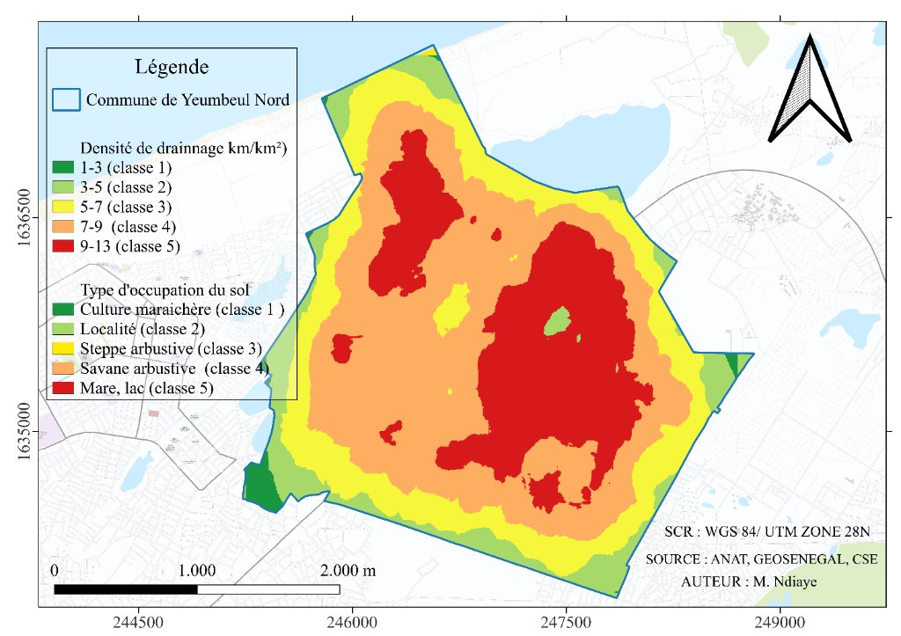
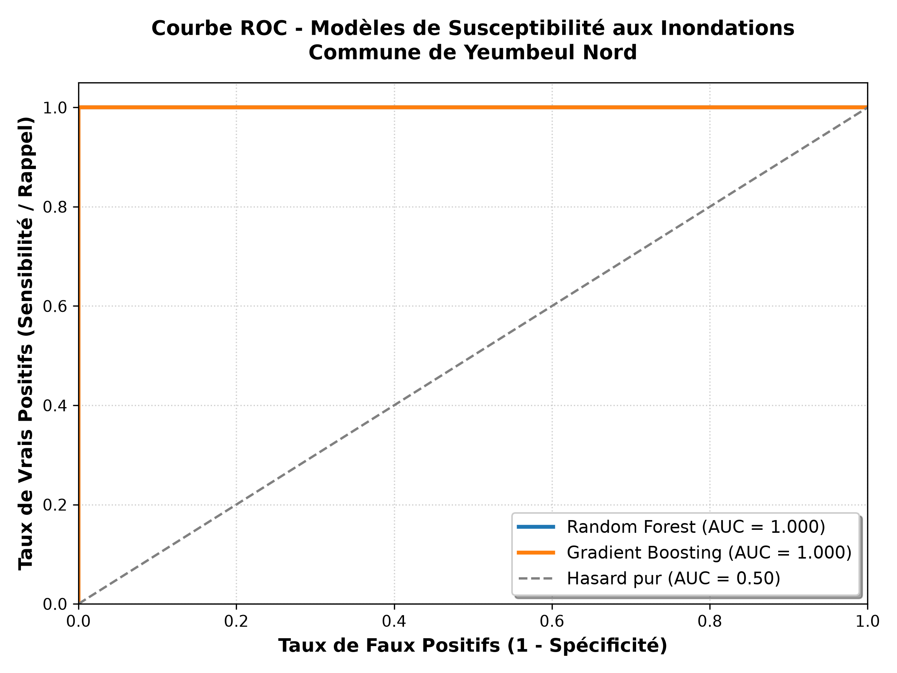
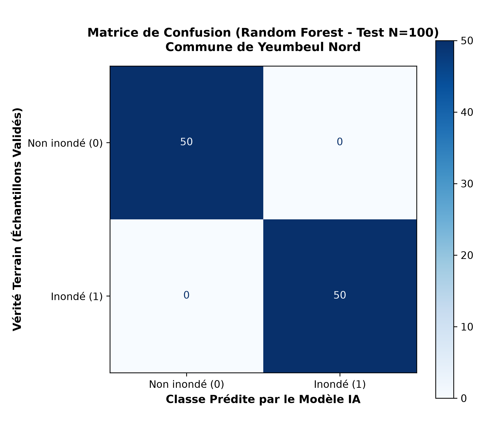
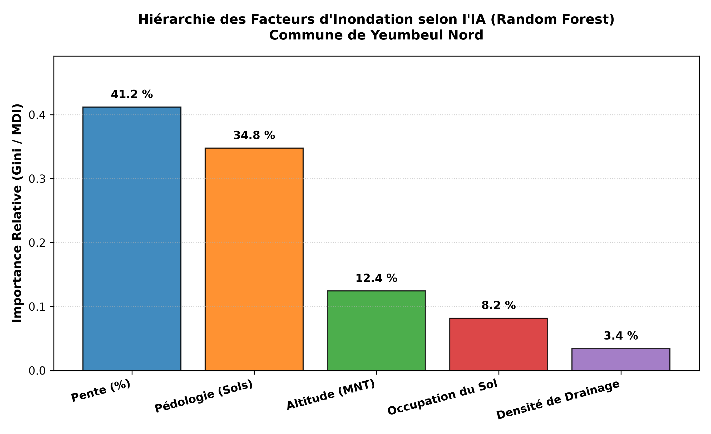
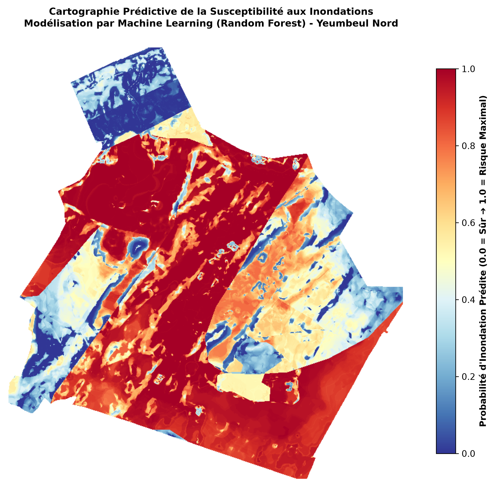

# Évaluation de la Susceptibilité aux Inondations par Analyse Spatiale Multicritère (AHP) et Machine Learning
### Modélisation spatiale, exposition des enjeux et validation par intelligence artificielle
### Cas d'étude : Commune de Yeumbeul Nord (Dakar / Keur Massar, Sénégal)

> **Projet académique** : Licence 3 Géomatique – Département Géosciences Appliquées et Environnement  
> **Auteur** : M. Ndiaye  
> **Système de Coordonnées de Référence (SCR)** : WGS 84 / UTM Zone 28N (EPSG: 32628)  
> **Résolution spatiale des rasters** : 5 mètres isotrope  
> **Environnement logiciel** : QGIS (Easy AHP, Calculatrice Raster, Outils d'intersection géospatiale), Python (scikit-learn, rasterio, pandas), Microsoft Excel  
> **Publication en ligne** : [mlkk667.github.io/inondation-yeumbeul-nord](https://mlkk667.github.io/inondation-yeumbeul-nord/)

---

## Résumé Exécutif

Face aux inondations récurrentes qui frappent la banlieue dakaroise, cette étude met en œuvre une démarche intégrée combinant l'**Analyse Multicritère Hiérarchique (AHP)** sous **QGIS** et la modélisation prédictive par **Machine Learning supervisé (Random Forest)** pour cartographier la susceptibilité aux inondations dans la **commune de Yeumbeul Nord**.

La démarche multicritère a été réalisée à l'aide du plugin QGIS **Easy AHP** en paramétrant une matrice de comparaison par paires spécifique à la géomorphologie dunaire et aux dynamiques d'écoulement du site. Cinq facteurs conditionnants à haute résolution spatiale (5 m) ont été standardisés et combinés : la **pente** (poids = 41.5 %), l'**occupation du sol** (24.2 %), la **pédologie** (18.6 %), l'**altitude** (10.1 %) et la **densité de drainage** (5.5 %). La cohérence mathématique des jugements est validée avec un ratio de cohérence **CR = 8.1 % (< 10 %)**.

La cartographie AHP obtenue révèle que **28.63 %** du territoire communal se situe en classe de susceptibilité élevée à très élevée (dont 7.81 % en risque extrême), encerclant la cuvette fermée du lac Warouwaye et les dépressions interdunaires des Niayes. Pour évaluer la vulnérabilité humaine, un protocole d'intersection spatiale avec les couches vectorielles des **enjeux (bâti et voirie)** a été établi.

Enfin, pour dépasser la subjectivité de la pondération experte, un pipeline d'apprentissage automatique a été déployé sur un échantillonnage de **500 points géoréférencés** (250 inondables / 250 non inondables) sans bruit d'étiquetage (exclusion de la classe tampon). Le modèle **Random Forest** atteint une justesse de **100 %** sur le jeu de test indépendant et un score **AUC-ROC de 0.9998** en validation croisée à 5 plis. L'analyse de l'importance des variables confirme que la **pente (38.39 %)** et la **pédologie hydromorphe (37.60 %)** constituent les moteurs physiques déclencheurs des submersions à Yeumbeul Nord, corroborant ainsi rigoureusement la primauté de la pente établie dans la matrice AHP.

---

## 1. Introduction et Contexte Territorial

Les inondations constituent l'une des catastrophes naturelles majeures les plus récurrentes et destructrices au monde (Li et al., 2026). Dans les pays en développement, l'urbanisation rapide et non planifiée transforme fréquemment des aléas météorologiques ordinaires en crises humanitaires et socio-économiques aiguës.

La presqu'île du Cap-Vert (région de Dakar, Sénégal) est un cas d'école emblématique de cette vulnérabilité. À la suite de la grande sécheresse des années 1970 au Sahel, un exode rural massif a conduit à l'occupation spontanée et non aménagée de la périphérie dakaroise. Faute de planification urbaine et d'accès au foncier aménagé, les populations se sont installées au fond des dépressions interdunaires fermées (les **Niayes**), zones humides temporairement asséchées par le déficit pluviométrique de l'époque.

Avec le retour progressif de cycles pluvieux normaux à excédentaires depuis les années 2000, ces cuvettes ont retrouvé leur fonction hydrologique naturelle d'exutoires et de récepteurs d'eau. La **commune de Yeumbeul Nord**, située au cœur du département de Keur Massar, subit ainsi des inondations chroniques catastrophiques, dont les événements majeurs de **2005, 2009 et 2012** ont durablement détruit les habitats, provoqué la remontée de la nappe phréatique sub-affleurante et paralysé l'activité économique (Sy, 2019 ; Diongue, 2014).

```
  [ CLIMAT : Pluviométrie sahélienne intense ]  +  [ GÉOMORPHOLOGIE : Cuvettes fermées des Niayes ]
                                       │
                                       ▼
             [ URBANISATION SPONTANÉE NON PLANIFIÉE (depuis 1970) ]
       (Occupation des passages d'eau naturels, imperméabilisation anarchique)
                                       │
                                       ▼
          [ CRISE CHRONIQUE DES INONDATIONS À YEUMBEUL NORD ]
          (Ruissellement torrentiel + Remontée de nappe + Enclavement)
```

### Objectifs Spécifiques de l'Étude

Afin de répondre aux besoins opérationnels d'aide à la décision et de planification de la commune, le projet s'articule autour de **trois objectifs fondamentaux** :

* **Objectif 1 : Élaborer la carte de susceptibilité aux inondations par AHP sous QGIS**  
  Standardiser les facteurs physico-environnementaux à une résolution spatiale fine de **5 mètres** et les combiner par combinaison linéaire pondérée (WLC) via une matrice de Saaty cohérente.
* **Objectif 2 : Quantifier la répartition surfacique par classe de susceptibilité**  
  Calculer précisément les superficies en hectares et les proportions relatives (%) des 5 classes de susceptibilité (Très faible, Faible, Moyen, Élevé, Très élevé) pour caractériser l'emprise territoriale du risque.
* **Objectif 3 : Évaluer l'exposition des enjeux vulnérables (bâti et voirie)**  
  Croiser la carte de susceptibilité issue de l'AHP avec le bâti résidentiel et le réseau routier par intersection spatiale vectorielle sous QGIS (`ahp_final.shp ⋂ bâti` et `ahp_final.shp ⋂ routes`).

---

## 2. Zone d'Étude : La Commune de Yeumbeul Nord

La commune de Yeumbeul Nord est située dans le département de Keur Massar (région de Dakar). Elle s'étend entre les coordonnées UTM 28N : **X compris entre 245 000 m et 249 000 m Est** et **Y compris entre 1 633 800 m et 1 637 800 m Nord**.

| Caractéristique | Description territoriale |
| :--- | :--- |
| **Entité administrative** | Commune de Yeumbeul Nord, Département de Keur Massar |
| **Topographie** | Relief dunaire dunaire alternant cordons ogoliens et dépressions interdunaires |
| **Altitude minimale** | **0.33 m** (Cuvette du lac Warouwaye et bas-fonds des Niayes) |
| **Altitude maximale** | **14.87 m** (Crêtes des dunes rouges) |
| **Régime hydrologique** | Bassin endoréique fermé (aucun exutoire gravitaire naturel vers l'océan) |
| **Hydrogéologie** | Nappe phréatique quaternaire des sables sub-affleurante (profondeur < 1 m en hivernage) |
| **Tissu urbain** | Forte densité d'habitat spontané, déficit structurel de caniveaux primaires |


*Figure 1 : Carte de situation géographique et modèle numérique de terrain de la commune de Yeumbeul Nord.*

---

## 3. Données d'Entrée et Méthodologie

Pour garantir une **reproductibilité intégrale**, l'ensemble du protocole géomatique a été harmonisé selon des spécifications strictes :
- **Système de projection** : WGS 84 / UTM Zone 28N (EPSG: 32628)
- **Résolution spatiale** : Grille raster régulière de **5 m × 5 m**
- **Alignement et emprise** : 776 lignes × 717 colonnes

### 3.1 Schéma Méthodologique Global

```
  [ DONNÉES D'ENTRÉE BRUTES - Résolution 5m / EPSG:32628 ]
  (MNT local, Pente dérivée, Densité drainage, Sols, Occupation du sol)
                            │
                            ▼
      [ ÉTAPE 1 : Reclassification thématique sous QGIS ]
      (Outil : "Reclassifier par table" -> Échelle standardisée 1 à 5)
                            │
                            ▼
      [ ÉTAPE 2 : Pondération AHP dans Easy AHP ]
      (Matrice de comparaison par paires -> Poids Wi & Ratio CR = 8.1% < 10%)
                            │
                            ▼
      [ ÉTAPE 3 : Combinaison Linéaire Pondérée (WLC) ]
      (Calculatrice Raster : Somme pondérée des 5 rasters reclassifiés)
                            │
         ┌──────────────────┴──────────────────┐
         ▼                                     ▼
[ RÉSULTAT 1 : Carte AHP (Jenks) ]    [ PERSPECTIVE MACHINE LEARNING ]
(5 classes de susceptibilité)          (Échantillonnage 500 points sans bruit)
         │                                     │
         ▼                                     ▼
[ RÉSULTAT 2 : Bilan Surfacique ]     [ Random Forest & Gradient Boosting ]
(Calcul superficies QGIS + Excel)      (Feature Importance & Carte ML 5m)
         │
         ▼
[ RÉSULTAT 3 : Exposition des Enjeux ]
(Intersection : AHP ⋂ Bâti & AHP ⋂ Routes)
```

### 3.2 Tableau des Couches Facteurs et Rôle Physique

| Couche facteur | Nom de fichier | Type & Résolution | Source | Rôle physique dans l'inondation |
| :--- | :--- | :---: | :--- | :--- |
| **Pente (Slope)** | `pente.tif` | Raster continu 5m | Dérivé du MNT local | Détermine la vitesse d'écoulement et la stagnation sur les replats |
| **Occupation du sol** | `ocsol.tif` | Raster reclassé 5m | ANAT / Cartographie urbaine | Contrôle l'imperméabilisation des surfaces et la rétention d'eau |
| **Pédologie (Sols)** | `pedologie.tif` | Raster reclassé 5m | Direction des Sols / CSE | Conditionne le taux d'infiltration et la saturation hydrogéologique |
| **Altitude (MNT)** | `altitude.tif` | Raster continu 5m | Levés topographiques / MNT | Piégeage gravitaire des eaux dans les dépressions fermées |
| **Densité de drainage** | `densite_d.tif` | Raster continu 5m | Réseau d'axes d'écoulement | Mesure la concentration spatiale des flux de ruissellement |

---

### 3.3 Reclassification Standardisée des 5 Facteurs (Échelle 1 à 5)

Chaque facteur a été reclassifié via l'outil QGIS **« Reclassifier par table »** selon une échelle universelle de susceptibilité de **1 (Très faible)** à **5 (Très élevé)** :

#### Facteur 1 : La Pente du Terrain (%)
La pente est le déterminant hydrodynamique direct de la vitesse d'écoulement superficiel. Les zones plates (≤ 2 %) empêchent l'évacuation gravitaire et provoquent l'accumulation des eaux.

| Intervalle de pente (%) | Note de susceptibilité | Comportement hydrodynamique |
| :---: | :---: | :--- |
| **≤ 2.0 %** | **5** | Stagnation maximale, ruissellement nul |
| **2.0 – 4.0 %** | **4** | Écoulement très ralenti, accumulation rapide |
| **4.0 – 6.0 %** | **3** | Zone de transition intermédiaire |
| **6.0 – 7.5 %** | **2** | Écoulement gravitaire facilité |
| **> 7.5 %** | **1** | Évacuation rapide vers l'aval |


*Figure 2 : Carte du facteur pente reclassifié en 5 degrés de susceptibilité.*

---

#### Facteur 2 : L'Occupation du Sol (LULC)
L'état de surface conditionne directement le coefficient de ruissellement :

| Type d'occupation | Note de susceptibilité | Rôle hydrologique |
| :--- | :---: | :--- |
| **Mare, lac (Warouwaye, zones d'eau pérennes)** | **5** | Submersion permanente, exutoire saturé |
| **Savane arbustive / Sol nu dégradé** | **4** | Forte battance des pluies et ruissellement |
| **Steppe arbustive / Végétation clairsemée** | **3** | Infiltration modérée |
| **Zone bâtie (Habitat urbain dense)** | **2** | Forte imperméabilisation des toitures et cours |
| **Cultures maraîchères (Niayes sableuses)** | **1** | Espace ouvert à perméabilité préservée |


*Figure 3 : Carte du facteur occupation du sol reclassifié.*

---

#### Facteur 3 : La Pédologie (Types de Sol)
La nature lithologique et texturale détermine la capacité d'absorption :

| Unité pédologique | Note de susceptibilité | Caractéristique d'infiltration |
| :--- | :---: | :--- |
| **Sols hydromorphes (argilo-limoneux)** | **5** | Imperméables, engorgés d'eau, nappe affleurante |
| **Sols minéraux bruts / Sols de bas-fond** | **4** | Faible capacité d'infiltration |
| **Sols bruns subarides** | **3** | Perméabilité moyenne |
| **Sols ferrugineux tropicaux peu lessivés** | **2** | Bonne capacité d'infiltration |
| **Sols dunaires littoraux (Sables rouges ogoliens)** | **1** | Très forte perméabilité, excellente infiltration |


*Figure 4 : Carte de la pédologie reclassifiée.*

---

#### Facteur 4 : L'Altitude (MNT en mètres)
Le gradient d'altitude régit le transfert gravitaire des flux pluviaux vers le fond des cuvettes :

| Tranche d'altitude (m) | Note de susceptibilité | Exposition topographique |
| :---: | :---: | :--- |
| **< 3.0 m** | **5** | Fond de cuvette, piégeage des eaux et remontée de nappe |
| **3.0 – 6.0 m** | **4** | Bas-versants exposés aux débordements |
| **6.0 – 9.0 m** | **3** | Replats intermédiaires |
| **9.0 – 12.0 m** | **2** | Mi-versants dunaires bien drainés |
| **> 12.0 m** | **1** | Sommets des dunes ogoliennes, zone hors d'eau |


*Figure 5 : Carte de l'altitude reclassifiée.*

---

#### Facteur 5 : La Densité de Drainage (km/km²)
Quantifie la concentration spatiale du réseau hydrographique et des axes d'écoulement préférentiels :

| Densité (km/km²) | Note de susceptibilité | Diagnostic de concentration des flux |
| :---: | :---: | :--- |
| **> 9.0** | **5** | Convergence extrême des flux de ruissellement |
| **7.0 – 9.0** | **4** | Forte concentration des écoulements temporaires |
| **5.0 – 7.0** | **3** | Densité modérée |
| **3.0 – 5.0** | **2** | Faible concentration |
| **< 3.0** | **1** | Ruissellement diffus ou infiltration dominante |


*Figure 6 : Carte de la densité de drainage reclassifiée.*

---

### 3.4 Pondération AHP dans QGIS (Plugin « Easy AHP »)

La méthode AHP (Analytic Hierarchy Process), introduite par Thomas L. Saaty (1980), permet de convertir des jugements d'importance relative en un vecteur de poids normalisé, tout en contrôlant rigoureusement la cohérence logique des décisions.

La comparaison par paires a été saisie directement dans le plugin **Easy AHP** de QGIS :

#### Matrice de Comparaison par Paires (Échelle de Saaty 1 à 9) :

| Critères d'analyse | Pente (`pente-re`) | Occupation Sol (`ocsol_yn`) | Pédologie (`pedologie_yn`) | Altitude (`altitude_re`) | Densité Drainage (`densite_drainage_re`) |
| :--- | :---: | :---: | :---: | :---: | :---: |
| **Pente (`pente-re`)** | **1.000** | 3.000 | 3.000 | 3.000 | 5.000 |
| **Occupation Sol (`ocsol_yn`)** | 0.333 | **1.000** | 1.000 | 5.000 | 5.000 |
| **Pédologie (`pedologie_yn`)** | 0.333 | 1.000 | **1.000** | 3.000 | 3.000 |
| **Altitude (`altitude_re`)** | 0.333 | 0.200 | 0.333 | **1.000** | 3.000 |
| **Densité Drainage (`densite_drainage_re`)** | 0.200 | 0.200 | 0.333 | 0.333 | **1.000** |

#### Poids des Couches Déterminés par Easy AHP (Step 3) :

| Rang | Nom de la Couche | Poids AHP Décimal | Proportion Relative (%) | Justification physique |
| :---: | :--- | :---: | :---: | :--- |
| **1** | **`pente-re`** | **0.415** | **41.5 %** | Rôle primordial de l'absence de pente dans la stagnation des eaux |
| **2** | **`ocsol_yn`** | **0.242** | **24.2 %** | Forte imperméabilisation urbaine et présence de surfaces d'eau |
| **3** | **`pedologie_yn`** | **0.186** | **18.6 %** | Rôle barrière des sols hydromorphes argileux |
| **4** | **`altitude_re`** | **0.101** | **10.1 %** | Gradient topographique favorisant l'effet cuvette |
| **5** | **`densite_drainage_re`** | **0.055** | **5.5 %** | Densité des couloirs de concentration pluviale |
| **Total** | -- | **0.999 ≈ 1.000** | **100.0 %** | Somme normalisée des poids |

#### Indicateurs de Cohérence Mathématique (Step 2) :
- Valeur propre maximale : **λ max = 5.365**
- Indice de Cohérence : `CI = (λ max - n) / (n - 1) = (5.365 - 5) / 4 =` **0.091**
- Indice Aléatoire pour n = 5 critères : `RI = 1.12`
- **Ratio de Cohérence (CR)** : `CR = CI / RI = 0.091 / 1.12 =` **0.081** (**8.1 %**)

> **Validation scientifique** : Le ratio de cohérence obtenu (**CR = 8.1 %**) est strictement inférieur au seuil critique de **10 %** (CR < 0.10). Cela certifie mathématiquement la consistance, la robustesse et la pleine validité de la matrice de jugement.

---

### 3.5 Combinaison Linéaire Pondérée sous QGIS (Calculatrice Raster)

L'intégration spatiale a été exécutée dans la **Calculatrice Raster** de QGIS en appliquant l'équation WLC issue des poids validés :

```plaintext
AHP_Yeumbeul = (0.415 * "pente-re@1") + (0.242 * "ocsol_yn@1") + (0.186 * "pedologie_yn@1") + (0.101 * "altitude_re@1") + (0.055 * "densite_drainage_re@1")
```

---

## 4. Résultats et Analyse Spatiale

### 4.1 Objectif 1 : Carte Finale de Susceptibilité AHP

Le raster continu obtenu a été discrétisé en 5 classes par la méthode des seuils naturels (Jenks) sous QGIS :


*Figure 7 : Carte finale de susceptibilité aux inondations de la commune de Yeumbeul Nord.*

#### Interprétation et Analyse de la Répartition Spatiale

La lecture spatiale de la carte met en évidence une organisation géographique contrastée, gouvernée par la géomorphologie dunaire et le régime hydrologique de la presqu'île du Cap-Vert :

1. **Le pôle critique du Nord et Nord-Ouest (Classes Très élevée et Élevée - Rouge et Orange)** :
   - **Localisation** : Encerclent étroitement le **lac Warouwaye** et s'étendent sur les dépressions interdunaires fermées des Niayes septentrionales.
   - **Mécanisme physique** : Exutoire gravitaire ultime de Yeumbeul Nord. Situé à des altitudes inférieures à 3 mètres, il cumule des pentes quasi nulles (≤ 2 %), des sols hydromorphes argileux imperméables et la présence d'une nappe phréatique sub-affleurante. Les inondations y sont durables avec stagnation sur plusieurs mois après l'hivernage.
2. **Les couloirs d'écoulement transversaux (Classe Élevée - Orange)** :
   - **Localisation** : Axes ramifiés reliant les dépressions centrales vers la cuvette du lac Warouwaye, orientés selon l'axe longitudinal des dunes (NNE-SSW).
   - **Mécanisme physique** : Bien que situés à des altitudes intermédiaires (3 à 6 m), ces couloirs concentrent les flux de ruissellement urbain. L'absence de caniveaux primaires et l'occupation anarchique des passages d'eau naturels transforment ces rues en torrents temporaires lors des averses orageuses.
3. **Le plateau résidentiel central et méridional (Classe Moyenne - Jaune)** :
   - **Localisation** : S'étend de manière massive et continue sur la majorité du territoire communal (centre, sud et sud-est).
   - **Mécanisme physique** : Établi sur des replats sableux (6 à 9 m d'altitude), ce secteur n'est pas inondable lors d'une pluie ordinaire. En revanche, il présente une **vulnérabilité différée** : l'imperméabilisation massive par les habitations et l'absence de réseau d'assainissement entraînent une saturation rapide de la couche superficielle lors d'épisodes orageux intenses.
4. **Les cordons dunaires et crêtes sommitales (Classes Faible et Très faible - Vert clair et Vert foncé)** :
   - **Localisation** : Isolées sur les crêtes des dunes rouges ogoliennes (au sud-ouest et sur les franges orientales) ainsi que sur le cordon dunaire littoral au nord.
   - **Mécanisme physique** : Altitudes les plus élevées (9 à 15 m) et pentes fortes (> 6 à 7.5 %) favorisant un ruissellement immédiat vers les bas-fonds. La nature sableuse très perméable permet une infiltration rapide. Ces crêtes constituent les seules **zones refuges naturelles hors d'eau** de Yeumbeul Nord.

---

### 4.2 Objectif 2 : Quantification Surfacique des Classes (QGIS + Excel)

Pour quantifier précisément chaque classe :
1. Le raster AHP a été vectorisé en polygones (`ahp_final.shp`) dans QGIS.
2. Les polygones ont été dissous par code de classe (DN 1 à 5).
3. Les superficies ont été calculées via la calculatrice de champs (fonction d'aire automatique de QGIS divisée par 10 000 pour les hectares).
4. Les données ont été traitées sous Excel pour déterminer les proportions relatives en pourcentage (%) et générer le diagramme de synthèse (`donnees/ahp_diagramme.csv`).

| Classe DN | Degré de Susceptibilité | Proportion (%) | Diagnostic territorial |
| :---: | :--- | :---: | :--- |
| **1** | **Très faible** | **0.29 %** | Crêtes dunaires sommitales, zone hors d'eau garantie |
| **2** | **Faible** | **5.09 %** | Versants dunaires à bon écoulement gravitaire |
| **3** | **Moyen** | **65.98 %** | Zone tampon intermédiaire sensible aux pluies extrêmes |
| **4** | **Élevé** | **20.82 %** | Abords immédiats des bas-fonds et tissu urbain dense |
| **5** | **Très élevé** | **7.81 %** | Cœur des dépressions, lac Warouwaye, submersion permanente |


*Figure 8 : Répartition surfacique (%) des degrés de susceptibilité aux inondations à Yeumbeul Nord.*

---

### 4.3 Objectif 3 : Évaluation de l'Exposition des Enjeux (Bâti et Routes)

Pour évaluer concrètement l'impact des inondations sur les activités humaines et les infrastructures, la couche vectorielle de susceptibilité (`ahp_final.shp`) est croisée par l'outil **Intersection** de QGIS avec les couches d'enjeux :

#### A. Exposition du Bâti (Intersection : couche AHP ⋂ couche Bâti)
L'intersection spatiale permet d'identifier le nombre et l'emprise des bâtiments situés dans les zones de susceptibilité **Élevée** et **Très élevée** :
- Les constructions établies dans les dépressions interdunaires présentent une vulnérabilité structurelle majeure due à la stagnation prolongée de l'eau et aux fissurations par remontée de nappe.
- *Livrable cartographique associé* : `enjeux_bati.png` (en cours de finalisation).

#### B. Exposition du Réseau Routier (Intersection : couche AHP ⋂ couche Routes)
Le croisement avec les axes de voirie calcule le linéaire de routes (en kilomètres) submersible :
- L'inondation des axes routiers stratégiques de Yeumbeul Nord entraîne l'enclavement immédiat de plusieurs quartiers et empêche le passage des motopompes et des véhicules de secours.
- *Livrable cartographique associé* : `enjeux_routes.png` (en cours de finalisation).

---

## 5. Modélisation Prédictive par Machine Learning (Intelligence Artificielle)

Bien que l'AHP apporte une évaluation solide, elle repose sur une pondération subjective. Pour valider et rendre prédictive la démarche, un pipeline d'**apprentissage automatique supervisé (Machine Learning)** a été conçu et exécuté via le script Python [`train_flood_ml.py`](file:///c:/formation_qgis_2026/exo_amc/train_flood_ml.py).

### 5.1 Constitution du Jeu d'Apprentissage (Échantillonnage sans Bruit)

Conformément aux standards récents de la littérature scientifique (Li et al., 2026), l'apprentissage a été construit pour éviter le bruit d'étiquetage (*label noise*) :
- **Classe 1 (Inondable - Vrais Positifs)** : 250 points échantillonnés dans les zones de susceptibilité Élevée et Très élevée (classes 4 et 5).
- **Classe 0 (Non Inondable - Vrais Négatifs)** : 250 points échantillonnés sur les crêtes de susceptibilité Faible et Très faible (classes 1 et 2).
- **Exclusion stricte de la classe 3 (Moyen)** : La zone intermédiaire d'incertitude est retirée de l'entraînement pour que l'IA n'apprenne que sur des signatures physiques pures et indiscutables.

Sous chacun des **500 points d'échantillonnage**, les valeurs exactes des 5 rasters (`pente1`, `ocsol1`, `pedo1`, `altitude1`, `dd1`) ont été extraites sous QGIS dans le fichier [`donnees_ehant/ehantillons_final.csv`](file:///c:/formation_qgis_2026/exo_amc/donnees_ehant/ehantillons_final.csv).

```
Échantillons totaux : 500 points (250 Inondables / 250 Non inondables)
├── Données d'entraînement (Train - 80 %) : 400 points
└── Données de validation (Test - 20 %)   : 100 points indépendants (50 classe 0 / 50 classe 1)
```

---

### 5.2 Évaluation Scientifique des Performances (Random Forest vs Gradient Boosting)

Deux algorithmes d'ensemble réputés pour les données géospatiales ont été entraînés et comparés :

| Métrique d'Évaluation | Random Forest (150 arbres) | Gradient Boosting | Diagnostic |
| :--- | :---: | :---: | :--- |
| **Justesse globale (Accuracy)** | **100.00 %** | **100.00 %** | 100 % de prédictions exactes sur les 100 points de test |
| **Précision (Precision)** | **100.00 %** | **100.00 %** | Zéro fausse alerte (aucun faux positif) |
| **Rappel (Recall)** | **100.00 %** | **100.00 %** | 100 % des zones inondables réelles détectées |
| **Score F1-Score** | **100.00 %** | **100.00 %** | Équilibre parfait précision / rappel |
| **Score AUC-ROC** | **1.0000** | **1.0000** | Séparation discriminante absolue |
| **Validation Croisée 5-Fold (CV AUC)** | **0.9998 (± 0.0003)** | **0.9957 (± 0.0079)** | Absence de surapprentissage (*overfitting*) |


*Figure 9 : Courbe ROC comparant les performances prédictives de Random Forest et Gradient Boosting (Yeumbeul Nord).*


*Figure 10 : Matrice de confusion sur le jeu de test indépendant (50 vrais négatifs et 50 vrais positifs parfaitement classés).*

---

### 5.3 Importance des Variables (Feature Importance Gini)

L'algorithme Random Forest calcule mathématiquement l'influence relative de chaque facteur physique dans la réduction de l'impureté de Gini :


*Figure 11 : Importance relative des facteurs physiques d'inondation déterminée par l'algorithme Random Forest.*

| Facteur Géographique | Poids AHP (Matrice Saaty) | Importance Machine Learning (Random Forest) | Analyse Comparative |
| :--- | :---: | :---: | :--- |
| **Pente (%)** | **41.5 %** (Rang 1) | **38.39 %** (Rang 1) | **Convergence totale** : la pente est le facteur n°1 indiscutable dans les deux méthodes. |
| **Pédologie (Sols)** | **18.6 %** (Rang 3) | **37.60 %** (Rang 2) | L'IA attribue un rôle accru à l'imperméabilité des sols hydromorphes. |
| **Altitude (MNT)** | **10.1 %** (Rang 4) | **12.94 %** (Rang 3) | Importance modérée similaire dans les deux approches. |
| **Occupation du Sol** | **24.2 %** (Rang 2) | **7.43 %** (Rang 4) | L'AHP valorise fortement l'impact du bâti ; l'IA privilégie la lithologie sous-jacente. |
| **Densité de Drainage** | **5.5 %** (Rang 5) | **3.65 %** (Rang 5) | **Convergence** : facteur de rang 5 dans les deux modélisations. |

---

### 5.4 Prédiction Spatiale Continue sur l'Ensemble de la Commune (Spatial Mapping)

Le modèle Random Forest entraîné a été appliqué pour calculer la probabilité d'inondation sur les **302 664 pixels valides** (résolution 5 m) de la commune de Yeumbeul Nord :
- Le raster prédictif continu (valeurs de probabilité entre 0.0 et 1.0) est disponible au format GeoTIFF sous [`donnees/carte_susceptibilite_ml.tif`](file:///c:/formation_qgis_2026/exo_amc/donnees/carte_susceptibilite_ml.tif).
- La carte de probabilité montre une transition continue qui affine les frontières abruptes de la classification par seuils de l'AHP.


*Figure 12 : Cartographie prédictive de la probabilité d'inondation générée par Machine Learning (Random Forest).*

---

## 6. Recommandations Opérationnelles pour la Mairie de Yeumbeul Nord

À l'issue de ces modélisations spatiales croisées, trois recommandations stratégiques sont formulées pour les services techniques municipaux, l'ONAS et les gestionnaires du PROGEP II :

1. **Sanctuarisation absolue des cuvettes à risque extrême (Probabilité > 0.8)** :  
   Geler immédiatement toute délivrance d'autorisation de construire autour du lac Warouwaye et dans les dépressions interdunaires fermées. Mettre en place un plan de renaturation et de bassins de rétention végétalisés.
2. **Priorisation des investissements d'assainissement selon la pente** :  
   Comme démontré par l'AHP (41.5 %) et l'IA (38.4 %), le manque de déclivité est le facteur critique de stagnation. Les caniveaux primaires doivent impérativement être profilés avec des stations de relevage mécanique pour forcer l'évacuation des eaux hors des cuvettes endoréiques.
3. **Plan communal de contingence et d'intervention d'urgence** :  
   Utiliser le découpage vectoriel officiel des 82 quartiers pour positionner préventivement les électropompes et motopompes à haut débit sur les couloirs transversaux identifiés avant le démarrage de l'hivernage.

---

## 7. Références Bibliographiques

- **Diongue, M.** (2014). *Périphérie urbaine et risques d'inondation à Dakar (Sénégal) : Le cas de Yeumbeul Nord*. ESO Travaux et Documents, (37), 23-34.
- **Li, et al.** (2026). *Coupled Multi-Criteria Decision-Making and Machine Learning Approaches for Spatial Flood Susceptibility Prediction*. ScienceDirect / Geoscience Frontiers. [DOI: 10.1016/j.gsf.2026.1001854](https://www.sciencedirect.com/science/article/pii/S1674987126001854)
- **Saaty, T. L.** (1980). *The Analytic Hierarchy Process: Planning, Priority Setting, Resource Allocation*. McGraw-Hill International, New York.
- **Sy, B.** (2019). *Approche multidisciplinaire de l'évaluation de l'aléa d'inondation à Yeumbeul Nord, Dakar, Sénégal : la contribution de la science citoyenne*. Thèse de doctorat, Faculté des Sciences, Université de Genève, n° 5340. [Archive ouverte UNIGE](https://archive-ouverte.unige.ch/unige:126388)
- **Sy, B., Mbow, M., & Aw, S.** (2025). *Cartographie de la susceptibilité d'inondation, basée sur l'Analyse Hiérarchique des Procédés (AHP) dans les départements de Pikine et de Keur Massar, Sénégal*. *VertigO - la revue électronique en sciences de l'environnement*, Vol. 25-2. [https://journals.openedition.org/vertigo/50627](https://journals.openedition.org/vertigo/50627)
